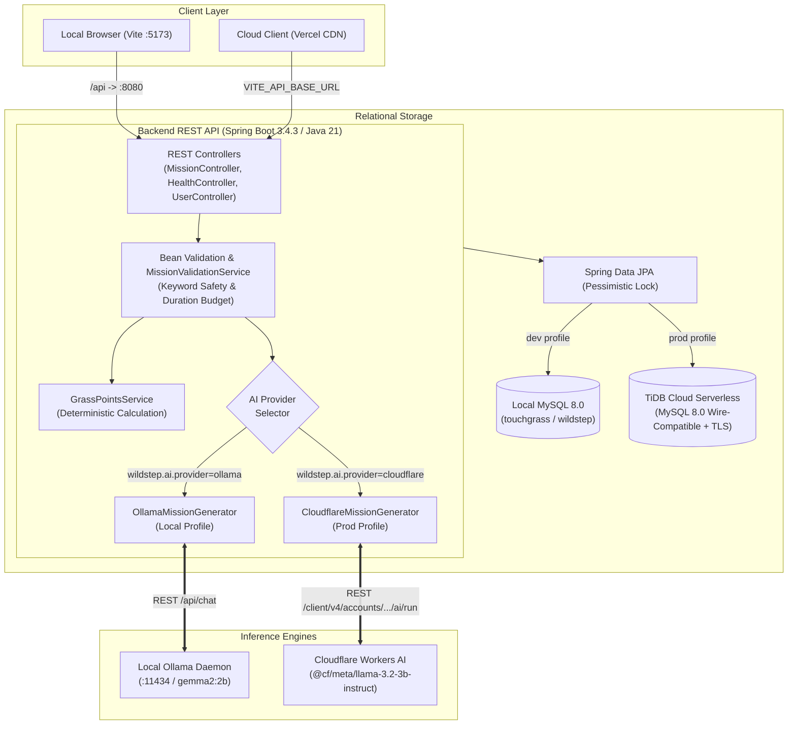

# WildStep 🌱

> **"AI that gets you to close the app."**  
> WildStep uses local open-weight AI (or serverless hosted open-weight models) to turn a user's mood, available time, goal, and surroundings into personalized outdoor missions. Users complete real-world tasks and earn Grass Points.

[](https://openjdk.org/projects/jdk/21/)
[](https://spring.io/projects/spring-boot)
[](https://react.dev/)
[](https://www.typescriptlang.org/)
[](https://vitejs.dev/)
[](https://tailwindcss.com/)
[](https://www.mysql.com/)
[](https://tidbcloud.com/)
[](https://developers.cloudflare.com/workers-ai/)
[](https://ollama.com/)
[](https://www.docker.com/)
[](https://vercel.com/)
[](https://render.com/)

---

## 📋 Table of Contents

- [Overview & Problem Statement](#-overview--problem-statement)
- [How It Works](#-how-it-works)
- [Screenshots & Demo](#-screenshots--demo)
- [Core Features](#-core-features)
- [Technology Stack](#-technology-stack)
- [System Architecture](#-system-architecture)
- [Request & Response Lifecycle](#-request--response-lifecycle)
- [Project Directory Structure](#-project-directory-structure)
- [Prerequisites](#-prerequisites)
- [Local Setup Guide (Windows PowerShell)](#-local-setup-guide-windows-powershell)
- [Free-Tier Cloud Deployment Guide](#-free-tier-cloud-deployment-guide)
  - [1. TiDB Cloud Starter Database Setup](#1-tidb-cloud-starter-database-setup)
  - [2. Cloudflare Workers AI Setup](#2-cloudflare-workers-ai-setup)
  - [3. Render Docker Backend Deployment](#3-render-docker-backend-deployment)
  - [4. Vercel Frontend Deployment](#4-vercel-frontend-deployment)
  - [5. Environment Variables Master Matrix](#5-environment-variables-master-matrix)
  - [6. Free-Tier Operational Nuances & Safeguards](#6-free-tier-operational-nuances--safeguards)
- [REST API Documentation](#-rest-api-documentation)
- [Grass Points Formula](#-grass-points-formula)
- [Safety, Privacy & Guardrails](#-safety-privacy--guardrails)
- [Automated Testing](#-automated-testing)
- [Troubleshooting](#-troubleshooting)
- [Project Status & Roadmap](#-project-status--roadmap)
- [Contributing](#-contributing)
- [License & Acknowledgements](#-license--acknowledgements)

---

## 🌍 Overview & Problem Statement

Modern digital life keeps people tethered to screens, leading to prolonged sitting, digital fatigue, and disconnection from physical surroundings. While numerous wellness apps attempt to address screen time, most paradoxically require users to stay inside the app for meditation, social feeds, or complex habit spreadsheets.

Furthermore, generic suggestions like *"take a 30-minute walk"* fail to account for:
- **How someone actually feels right now** (stressed, tired, anxious, bored, or energetic).
- **Real-world time constraints** (e.g., having exactly 15 minutes between university lectures).
- **Immediate surroundings** (a university campus, a suburban neighborhood, a small balcony, or a local public park).

**WildStep** flips this paradigm. Instead of maximizing user retention inside an interface, WildStep uses open-weight language models (Google Gemma 2 2B via local Ollama, or Meta Llama 3.1 8B via Cloudflare Workers AI) to generate tailored, time-bounded outdoor missions. Users receive grounded physical tasks, close the browser, complete them in the real world, and return to check off tasks and log their deterministic **Grass Points**.

> **Disclaimer:** WildStep is an open-source productivity and wellness utility designed to encourage outdoor physical breaks. It is not a medical application and does not diagnose, treat, or manage anxiety, clinical depression, screen addiction, or any medical condition.

---

## ⚙️ How It Works

The complete end-to-end user workflow operates across a strict separation of concerns between AI generation and backend state management:

```
[User Form Selection] ──► [Spring Boot REST API] ──► [AI: Local Ollama OR Cloudflare Workers AI]
                                     │                                      │
                                     ▼                                      ▼
                          [DB Save & Idempotent API] ◄────────────── [Validation Guardrails]
                                     │
                                     ▼
                          [Interactive Task Tracking] ──► [Grass Points Awarded]
```

1. **User Input:** The user selects available time (5–90 min), current mood, personal goal, immediate surroundings, difficulty, and companion context via the React interface.
2. **API Dispatch:** The frontend sends a validated `POST /api/missions/generate` request to the Spring Boot REST API.
3. **Dual AI Inference Engines:** 
   - **Local Development:** Spring Boot invokes the local Ollama daemon (`http://localhost:11434/api/chat`, model `gemma2:2b`).
   - **Cloud Production:** Spring Boot securely calls Cloudflare Workers AI (`@cf/meta/llama-3.2-3b-instruct`) using server-side API tokens without requiring costly GPU instances.
4. **Structured JSON Output:** The language model produces a structured JSON mission consisting of a title, description, 2–5 sequential tasks with minute estimates, and an optional bonus challenge.
5. **Backend Validation Guardrails:** The backend validation engine inspects the generated output, enforcing schema constraints, duration budgets, and scanning for forbidden hazard keywords.
6. **Relational Persistence:** Valid missions and tasks are saved to MySQL (locally) or TiDB Cloud Serverless (production) in a single `@Transactional` database write.
7. **Task Presentation:** The React frontend renders the mission card with an interactive progress bar, countdown badges, and task checkboxes.
8. **Real-World Execution:** The user steps outside and performs the physical tasks.
9. **Idempotent Progress Updates:** The user checks off each task via `PATCH /api/missions/{missionId}/tasks/{taskId}/complete`. The backend moves the mission from `CREATED` to `IN_PROGRESS` and eventually `COMPLETED`.
10. **Deterministic Reward:** Upon completion of all required tasks, the backend calculates deterministic Grass Points using database pessimistic locking (`LockModeType.PESSIMISTIC_WRITE`) to prevent duplicate rewards under race conditions.

---

## 📸 Screenshots & Demo

| Mission Configuration Form | Interactive Outdoor Task Checklist |
| :---: | :---: |
| *`docs/images/mission-form.png`* *(Placeholder)* | *`docs/images/mission-active.png`* *(Placeholder)* |

| System Health & Status Banner | Mission Completed & Grass Points Trophy |
| :---: | :---: |
| *`docs/images/dashboard-health.png`* *(Placeholder)* | *`docs/images/mission-completed.png`* *(Placeholder)* |

- **Live Demo:** *Coming soon (see [Free-Tier Cloud Deployment Guide](#-free-tier-cloud-deployment-guide))*
- **Repository URL:** `https://github.com/pushptandekar24-glitch/wildstep`

---

## ✨ Core Features

### Implemented Features
- 🧠 **Dual AI Generation Engine:**
  - **Local Development:** Ollama with `gemma2:2b` for offline, 100% private execution without third-party API keys.
  - **Free Cloud Production:** Cloudflare Workers AI with `@cf/meta/llama-3.2-3b-instruct`, utilizing Cloudflare's free daily 10,000 neurons allowance.
- 🛡️ **Multi-Tier Safety Guardrails:** Programmatic keyword filtering blocks unsafe activities (e.g., trespassing, railway proximity, climbing, highway traffic, or approaching strangers).
- ⏱️ **Duration Budget Enforcement:** Ensures the cumulative time of generated tasks never exceeds the user's selected available window.
- 🗄️ **Relational Persistence (MySQL & TiDB Cloud):** Missions and tasks persist with relational integrity (`CascadeType.ALL`, orphan removal), fully compatible with TiDB Serverless.
- 🔄 **Idempotent Task Completion:** Tasks can be completed individually; repeat requests safely return the current state without duplicating point allocations.
- 🔒 **Race Condition Protection:** Pessimistic write locking (`@Lock(LockModeType.PESSIMISTIC_WRITE)`) guarantees Grass Points are awarded exactly once.
- 🎯 **Deterministic Grass Points Engine:** Transparent, mathematically bounded formula rewarding both completion and verified outdoor duration.
- 🔍 **Mission Lookup by ID:** Retrieve any previously saved mission and resume real-time checklist progress.
- 🩺 **Integrated Health Monitoring:** Dedicated `GET /api/health` status check reporting application metadata.
- 🎨 **Responsive Dark UI:** Crafted with React 18, Vite, TypeScript, and Tailwind CSS, featuring real-time progress bars, micro-animations, and accessible form controls.
- ☁️ **Cloud-Ready Free-Tier Stack:** Containerized with Docker for Render, frontend deployable to Vercel, serverless database on TiDB Cloud.

### Future Roadmap
- ❌ Third-party cloud authentication / OAuth2 logins (currently supports anonymous missions and optional local user IDs).
- ❌ GPS geolocation tracking or smartphone sensor validation (tasks are completed via self-reported user action).
- ❌ Live weather API integrations.
- ❌ Photo verification uploads or vision-model analysis.
- ❌ Global social leaderboards or public follower feeds.

---

## 💻 Technology Stack

| Layer | Technology | Version | Purpose |
| :--- | :--- | :--- | :--- |
| **Runtime & Language** | OpenJDK (Java) | `21 LTS` | Core backend runtime utilizing modern language features |
| **Backend Framework** | Spring Boot | `3.4.3` | REST web services, dependency injection, component management (`wildstep-backend`) |
| **Persistence & ORM** | Spring Data JPA / Hibernate | Bundled | Object-relational mapping, custom repository queries, row locking |
| **Primary Database** | MySQL / TiDB Cloud | `8.0+` | Relational persistent database engine (MySQL locally, TiDB Serverless in cloud) |
| **Test Database** | H2 Database Engine | Bundled | In-memory database for fast, isolated test suite execution (`jdbc:h2:mem:wildsteptest`) |
| **Database Migrations**| Flyway | `10.x` | Database schema migrations (`V1__init_schema.sql`) with production validation |
| **Validation** | Jakarta Bean Validation | Bundled | Request DTO constraint validation (`@NotNull`, `@Size`, `@Min`) |
| **Local AI Engine** | Ollama | `0.3+` | Local LLM inference server managing model weights (`gemma2:2b`) |
| **Cloud AI Engine** | Cloudflare Workers AI | API v4 | Hosted serverless LLM inference (`@cf/meta/llama-3.2-3b-instruct`) on free tier |
| **HTTP Client** | Spring `RestClient` | Bundled | Synchronous HTTP client connecting backend to Ollama or Cloudflare |
| **JSON Serialization** | Jackson | Bundled | JSON serialization, deserialization, and schema binding |
| **Frontend Framework** | React | `18.2.0` | UI component architecture and client-side reactive state (`wildstep-frontend`) |
| **Language** | TypeScript | `5.3.3` | Type safety, enum synchronization, compile-time validation |
| **Build Tool & Bundler**| Vite | `5.4.21`| Fast ESM development server and Rollup production bundler |
| **Styling** | Tailwind CSS | `3.4.1` | Utility-first responsive design, dark mode theme palette |
| **Iconography** | `lucide-react` | `0.344.0`| Crisp vector icons (`Loader2`, `Compass`, `Trophy`, `Leaf`) |
| **Containerization** | Docker | Multi-stage | Multi-stage build running Java 21 on Render with memory tuning |
| **Automated Testing** | JUnit 5 & Mockito | Bundled | Unit, WebMvcTest, and end-to-end integration tests (62/62 passing) |

---

## 🏛️ System Architecture

WildStep is architected with a decoupled frontend and backend. In local development, the application runs entirely on your local machine. In cloud production, it deploys across free-tier serverless and containerized services:



---

## 🔄 Request & Response Lifecycle

### 1. Mission Generation (`POST /api/missions/generate`)
1. **Validation:** `@Valid` checks that `availableMinutes` is between 5 and 180, `goal` does not exceed 100 characters, and enums match domain definitions.
2. **Prompt Assembly & Provider Dispatch:**
   - In `ollama` mode: constructs structured JSON schema request to Ollama.
   - In `cloudflare` mode: constructs REST request to Cloudflare Workers AI with markdown stripping and JSON extraction.
3. **Inference & Retry:** AI generates the response. The service retries up to 2 times if JSON parsing fails.
4. **Safety Screening:** `MissionValidationService` verifies total task duration $\le$ requested duration, task count is between 2 and 5, and scans all text against 15 forbidden safety keywords.
5. **Database Transaction:** The mission and tasks are persisted via `MissionRepository.save(mission)` in a single transaction.
6. **Response:** Returns `201 Created` with database IDs for both the mission and individual tasks.

### 2. Task Completion (`PATCH /api/missions/{missionId}/tasks/{taskId}/complete`)
1. **Locking:** Spring Boot acquires a row write lock (`SELECT ... FOR UPDATE`) on the target mission.
2. **Ownership Check:** Verifies that the task belongs to the specified mission. If the task belongs to another mission, returns `409 Conflict`. If nonexistent, returns `404 Not Found`.
3. **Status Check:** If the mission is `CANCELLED`, rejects completion with `409 Conflict`.
4. **Idempotency Guard:** If the task is already marked `completed = true`, returns current state without duplicate rewards.
5. **State Progression:** Marks task complete and transitions status from `CREATED` $\to$ `IN_PROGRESS`.
6. **Completion & Rewards:** If all tasks are completed:
   - Sets status to `COMPLETED` and records `completedAt`.
   - Computes Grass Points using the verified duration contract.
   - Updates `Mission.pointsAwarded`.
   - If linked to a registered user (`userId != null`), atomically increments `User.totalPoints`.
   - Commits transaction and releases row lock.

---

## 📁 Project Directory Structure

```
wildstep/
├── .gitignore                          # Git exclusions (build artifacts, logs, .env)
├── README.md                           # Master project documentation
│
├── backend/                            # Spring Boot 3.4.3 backend service (com.wildstep)
│   ├── Dockerfile                      # Multi-stage production container build for Render
│   ├── .dockerignore                   # Docker build exclusions
│   ├── pom.xml                         # Maven dependencies & build metadata
│   └── src/
│       ├── main/
│       │   ├── java/com/wildstep/
│       │   │   ├── WildStepApplication.java      # Spring Boot application entry point
│       │   │   ├── config/
│       │   │   │   ├── CloudflareConfig.java     # RestClient bean for Cloudflare Workers AI
│       │   │   │   ├── OllamaConfig.java         # RestClient bean for local Ollama
│       │   │   │   └── WebCorsConfig.java        # Dynamic CORS allowed origins
│       │   │   ├── controller/
│       │   │   │   ├── HealthController.java     # GET /api/health monitoring endpoint
│       │   │   │   ├── MissionController.java    # /api/missions lifecycle endpoints
│       │   │   │   └── UserController.java       # /api/users management endpoints
│       │   │   ├── domain/
│       │   │   │   ├── Mission.java              # JPA Entity representing an outdoor mission
│       │   │   │   ├── MissionTask.java          # JPA Entity representing a mission sub-task
│       │   │   │   ├── User.java                 # JPA Entity representing a registered user
│       │   │   │   └── enums/
│       │   │   │       ├── Difficulty.java       # EASY, MEDIUM, HARD
│       │   │   │       ├── EnvironmentType.java  # CAMPUS, PARK, NEIGHBORHOOD, etc.
│       │   │   │       ├── MissionStatus.java    # CREATED, IN_PROGRESS, COMPLETED, CANCELLED
│       │   │   │       ├── Mood.java             # STRESSED, TIRED, ANXIOUS, BORED, ENERGETIC
│       │   │   │       └── Participants.java     # SOLO, FRIENDS, FAMILY
│       │   │   ├── dto/
│       │   │   │   ├── ApiErrorResponse.java     # RFC 7807 structured error payload
│       │   │   │   ├── ApiResponse.java          # Generic envelope: success, message, data
│       │   │   │   ├── MissionGenerateRequestDto.java # Validated mission prompt parameters
│       │   │   │   ├── MissionResponseDto.java   # Full mission detail response
│       │   │   │   ├── MissionTaskResponseDto.java   # Task detail response
│       │   │   │   ├── TaskCompletionRequestDto.java # Optional actual duration payload
│       │   │   │   ├── UserCreateRequestDto.java # User creation payload
│       │   │   │   ├── UserResponseDto.java      # User data response
│       │   │   │   ├── cloudflare/
│       │   │   │   │   ├── CloudflareAiRequest.java  # Workers AI request DTO
│       │   │   │   │   └── CloudflareAiResponse.java # Workers AI response DTO
│       │   │   │   └── ollama/
│       │   │   │       ├── OllamaChatRequest.java    # Ollama chat completion request
│       │   │   │       └── OllamaChatResponse.java   # Ollama chat completion response
│       │   │   ├── exception/
│       │   │   │   ├── AiServiceUnavailableException.java # HTTP 503 mapping for Cloudflare/AI
│       │   │   │   ├── ConflictException.java          # HTTP 409 mapping
│       │   │   │   ├── GlobalExceptionHandler.java     # Centralized @RestControllerAdvice
│       │   │   │   ├── MissionValidationException.java # HTTP 422 mapping
│       │   │   │   ├── OllamaUnavailableException.java # HTTP 503 mapping for Ollama
│       │   │   │   └── ResourceNotFoundException.java  # HTTP 404 mapping
│       │   │   ├── repository/
│       │   │   │   ├── MissionRepository.java      # JPA repository with pessimistic locking
│       │   │   │   ├── MissionTaskRepository.java  # Task retrieval by mission
│       │   │   │   └── UserRepository.java         # User persistence & lookups
│       │   │   └── service/
│       │   │       ├── GrassPointsService.java     # Deterministic reward calculation
│       │   │       ├── MissionService.java         # Mission generation, retrieval & completion
│       │   │       ├── MissionValidationService.java # Safety keyword & duration checks
│       │   │       ├── UserService.java            # User registration & profile management
│       │   │       └── ai/
│       │   │           ├── CloudflareMissionGenerator.java # Cloudflare Workers AI provider
│       │   │           ├── MissionGenerator.java   # AI inference abstraction interface
│       │   │           └── OllamaMissionGenerator.java     # Local Ollama RestClient provider
│       │   └── resources/
│       │       ├── application.yml                 # Base Spring config (PORT, CORS, wildstep.ai.provider)
│       │       ├── application-dev.yml             # Development profile (local MySQL & Ollama)
│       │       ├── application-prod.yml            # Production profile (TiDB, Flyway validate, Cloudflare)
│       │       ├── application-test.yml            # Test profile (H2 in-memory & fast timeouts)
│       │       └── db/migration/
│       │           └── V1__init_schema.sql         # Flyway schema: users, missions, tasks
│       └── test/java/com/wildstep/
│           ├── WildStepApplicationTests.java       # Spring context verification
│           ├── controller/
│           │   ├── MissionControllerTest.java      # MockMvc WebMvcTests for mission routes
│           │   └── UserControllerTest.java         # MockMvc WebMvcTests for user routes
│           └── service/
│               ├── GrassPointsServiceTest.java     # Formula boundary & capping tests
│               ├── MissionLifecycleIntegrationTest.java # H2 End-to-end database tests
│               ├── MissionLifecycleServiceTest.java# Concurrency, state & ownership tests
│               ├── MissionValidationServiceTest.java # Guardrail & keyword screening tests
│               └── ai/
│                   ├── CloudflareMissionGeneratorTest.java # Cloudflare mock HTTP & retry tests
│                   └── OllamaMissionGeneratorTest.java     # Ollama JSON parsing & retry tests
│
└── frontend/                           # React 18 + Vite + Tailwind CSS client (wildstep-frontend)
    ├── index.html                      # Single-page HTML entry point (<title>WildStep</title>)
    ├── package.json                    # Package metadata (name: "wildstep-frontend")
    ├── postcss.config.js               # PostCSS plugins (Tailwind, Autoprefixer)
    ├── tailwind.config.js              # Tailwind theme, colors & font family
    ├── tsconfig.json                   # TypeScript compiler configuration
    ├── vercel.json                     # Vercel SPA routing rewrite configuration
    ├── vite.config.ts                  # Vite config with /api -> :8080 proxy
    └── src/
        ├── App.tsx                     # Main application layout, form, & task card
        ├── index.css                   # Global styles & Tailwind base directives
        ├── main.tsx                    # React DOM root render
        ├── api/
        │   └── client.ts               # Typed fetch client reading VITE_API_BASE_URL
        ├── components/
        │   ├── HealthStatus.tsx        # System health banner querying /api/health
        │   └── Navbar.tsx              # Header with WildStep logo & Hacktoberfest badge
        └── types/
            └── index.ts                # TypeScript interfaces aligned with backend DTOs
```

---

## 📦 Prerequisites

Ensure the following tools are installed on your machine for local development:

| Requirement | Minimum Version | Verification Command | Notes |
| :--- | :--- | :--- | :--- |
| **Java Development Kit (JDK)** | `21 LTS` | `java -version` | Tested with OpenJDK 21 / 25 |
| **Apache Maven** | `3.9+` | `mvn -version` | Required (no Maven wrapper script included) |
| **Node.js & npm** | `Node 20+` / `npm 10+` | `node -v` ; `npm -v` | Frontend development & build |
| **MySQL Server** | `8.0+` | `mysql --version` | Running locally on port `3306` |
| **Ollama** | `0.3+` | `ollama --version` | Running locally on port `11434` (for local AI mode) |
| **Docker** | `24+` | `docker --version` | Optional (for testing container build locally) |

---

## 🚀 Local Setup Guide (Windows PowerShell)

Follow this step-by-step walkthrough to get WildStep running locally on Windows using PowerShell with local MySQL and Ollama.

### Step 1: Clone the Repository
```powershell
git clone https://github.com/pushptandekar24-glitch/wildstep.git
cd wildstep
```

### Step 2: Set Up MySQL
Open MySQL Command Line Client or MySQL Workbench:
```sql
CREATE DATABASE IF NOT EXISTS wildstep CHARACTER SET utf8mb4 COLLATE utf8mb4_unicode_ci;
```
*(Note: If you already have an existing local database named `touchgrass`, it is fully supported by the default fallback configuration without any data loss).*

### Step 3: Configure Environment Variables
Set your environment variables in your current PowerShell session. **Never hardcode passwords in configuration files.**

```powershell
# Set your MySQL database credentials (replace with your local password)
$env:SPRING_DATASOURCE_URL = "jdbc:mysql://localhost:3306/wildstep?createDatabaseIfNotExist=true&useSSL=false&allowPublicKeyRetrieval=true&serverTimezone=UTC"
$env:SPRING_DATASOURCE_USERNAME = "root"
$env:SPRING_DATASOURCE_PASSWORD = "YourSecurePasswordHere"

# Optional: Ollama settings (defaults to localhost:11434 with gemma2:2b)
$env:OLLAMA_BASE_URL = "http://localhost:11434"
$env:OLLAMA_MODEL = "gemma2:2b"
$env:OLLAMA_TIMEOUT_SECONDS = "30"
```

### Step 4: Pull and Start the Ollama Model
1. Ensure Ollama is running (`ollama serve` or system tray).
2. Pull the default open-weight model:
```powershell
ollama pull gemma2:2b
```

### Step 5: Start the Spring Boot Backend
Open a PowerShell terminal in the `backend/` directory:
```powershell
cd backend
mvn clean spring-boot:run
```
Test the health check:
```powershell
curl http://localhost:8080/api/health
```
**Expected response:**
```json
{"success":true,"message":"Backend service operational","data":{"status":"UP","application":"WildStep","phase":"Phase 1a Foundation"}}
```

### Step 6: Start the React Frontend
Open a **new** PowerShell terminal in the `frontend/` directory:
```powershell
cd frontend
npm install
npm run dev
```
Open **`http://localhost:5173`** in your browser.

---

## ☁️ Free-Tier Cloud Deployment Guide

WildStep is specifically architected for a zero-cost, free-tier cloud deployment utilizing:
- **Frontend**: [Vercel](https://vercel.com/) (Free Hobby Tier — static global CDN).
- **Backend**: [Render](https://render.com/) (Free Web Service — Docker runtime).
- **Database**: [TiDB Cloud Starter](https://tidbcloud.com/) (Free Serverless Tier — 5 GiB storage, MySQL 8.0 wire-compatible).
- **Inference**: [Cloudflare Workers AI](https://developers.cloudflare.com/workers-ai/) (Free Tier — 10,000 neurons/day for `@cf/meta/llama-3.2-3b-instruct`).

```
[Vercel Global CDN]  ──────────►  [Render Free Web Service]  ──────────►  [TiDB Cloud Serverless]
(React 18 + Vite SPA)             (Docker: Java 21 / Spring Boot)           (MySQL Wire-Compatible + TLS)
                                                │
                                                ▼
                                   [Cloudflare Workers AI]
                                (@cf/meta/llama-3.2-3b-instruct)
```

---

### 1. TiDB Cloud Starter Database Setup

1. Sign up for a free account at [TiDB Cloud](https://tidbcloud.com/).
2. Click **Create Cluster** and select **Serverless (Free)**.
3. Choose your preferred cloud region (select one close to your Render deployment region, e.g., US-East or Frankfurt).
4. After cluster creation, click **Connect** in the TiDB Cloud dashboard.
5. In the connection modal:
   - Select **Connection Type**: `General` or `Spring Boot / JDBC`.
   - TiDB will generate a secure root password. **Copy this password immediately** (it is only displayed once).
   - Note the **Gateway Host** (e.g., `gateway01.us-east-1.prod.aws.tidbcloud.com`), **Port** (`4000`), and **Username** (note: TiDB Cloud usernames have a prefix format like `xxxxxxxx.root`).
6. Construct your JDBC URL using mandatory TLS parameters:
   ```
   jdbc:mysql://<GATEWAY_HOST>:4000/<DATABASE_NAME>?sslMode=VERIFY_IDENTITY&enabledTLSProtocols=TLSv1.2,TLSv1.3
   ```
   *(e.g., `jdbc:mysql://gateway01.us-east-1.prod.aws.tidbcloud.com:4000/wildstep?sslMode=VERIFY_IDENTITY&enabledTLSProtocols=TLSv1.2,TLSv1.3`)*
7. **Flyway & Hibernate Compatibility**: In production (`application-prod.yml`), `spring.flyway.enabled: true` runs [`V1__init_schema.sql`](backend/src/main/resources/db/migration/V1__init_schema.sql) automatically on first boot, creating tables and constraints. Hibernate is set to `ddl-auto: validate` to guarantee strict schema safety.

---

### 2. Cloudflare Workers AI Setup

1. Sign up for a free account at [Cloudflare](https://dash.cloudflare.com/).
2. Navigate to **AI** > **Workers AI**.
3. Under **Overview**, find and copy your **Account ID** (a 32-character hexadecimal string).
4. Click **Manage API Tokens** > **Create Token**.
5. Select the **Workers AI (Read / Edit)** template (or create a custom token granting `Account` > `Workers AI` > `Read` + `Edit` permissions).
6. Click **Continue to summary** and **Create Token**. Copy the generated **API Token** securely.
7. **Free Quota**: Cloudflare provides 10,000 neurons per day for free, resetting every 24 hours at midnight UTC. This comfortably covers ~100–150 mission generations daily using `@cf/meta/llama-3.2-3b-instruct`.

---

### 3. Render Docker Backend Deployment

1. Sign up or log into [Render](https://render.com/).
2. Click **New +** > **Web Service**.
3. Connect your GitHub repository: `https://github.com/pushptandekar24-glitch/wildstep`.
4. Configure the service settings:
   - **Name**: `wildstep-backend` (or your preferred name).
   - **Region**: Select the region matching or closest to your TiDB Cloud cluster.
   - **Language / Environment**: `Docker`.
   - **Root Directory**: `backend`.
   - **Dockerfile Path**: `Dockerfile` (or `backend/Dockerfile` depending on root setting).
   - **Instance Type**: `Free` (0.1 CPU, 512 MB RAM).
5. Add the **Environment Variables** under the **Environment** tab:

| Variable Key | Value / Example | Notes |
| :--- | :--- | :--- |
| `SPRING_PROFILES_ACTIVE` | `prod` | Activates `application-prod.yml` |
| `SPRING_DATASOURCE_URL` | `jdbc:mysql://<GATEWAY_HOST>:4000/<DB>?sslMode=VERIFY_IDENTITY` | TiDB Cloud JDBC string with TLS |
| `SPRING_DATASOURCE_USERNAME` | `<prefix>.root` | TiDB generated username |
| `SPRING_DATASOURCE_PASSWORD` | `<your-tidb-password>` | TiDB generated password |
| `AI_PROVIDER` | `cloudflare` | Switches from Ollama to Cloudflare |
| `CLOUDFLARE_ACCOUNT_ID` | `<your-32-char-account-id>` | Cloudflare Account ID |
| `CLOUDFLARE_API_TOKEN` | `<your-cloudflare-token>` | Cloudflare secret token |
| `CLOUDFLARE_MODEL` | `@cf/meta/llama-3.2-3b-instruct` | Free-tier open-weight model |
| `CORS_ALLOWED_ORIGINS` | `https://wildstep.vercel.app,https://*.vercel.app` | Your deployed Vercel domain(s) |

6. Click **Deploy Web Service**.
7. Once deployed, Render will provide a service URL: `https://wildstep-backend.onrender.com`.
8. Verify startup by testing the health endpoint:
   `https://wildstep-backend.onrender.com/api/health`

---

### 4. Vercel Frontend Deployment

1. Sign up or log into [Vercel](https://vercel.com/).
2. Click **Add New...** > **Project**.
3. Import your GitHub repository: `pushptandekar24-glitch/wildstep`.
4. Configure the project:
   - **Framework Preset**: `Vite`.
   - **Root Directory**: Click *Edit* and select **`frontend`**.
   - **Build Command**: `npm run build`.
   - **Output Directory**: `dist`.
5. Add the **Environment Variable**:

| Variable Key | Value | Notes |
| :--- | :--- | :--- |
| `VITE_API_BASE_URL` | `https://wildstep-backend.onrender.com/api` | Your Render backend URL + `/api` |

6. Click **Deploy**.
7. Vercel builds the SPA and assigns a domain (e.g., `https://wildstep.vercel.app`).
8. Return to Render and ensure `CORS_ALLOWED_ORIGINS` includes your new Vercel domain.

---

### 5. Environment Variables Master Matrix

| Variable Name | Component | Profile | Description | Secrets Status |
| :--- | :--- | :--- | :--- | :--- |
| `PORT` | Backend | `All` | Server listening port (Render sets this dynamically) | Public |
| `SPRING_PROFILES_ACTIVE` | Backend | `All` | Active Spring profile (`dev`, `prod`, `test`) | Public |
| `SPRING_DATASOURCE_URL` | Backend | `dev / prod` | JDBC connection URL (local MySQL or TiDB Cloud) | Sensitive |
| `SPRING_DATASOURCE_USERNAME` | Backend | `dev / prod` | Database username | Sensitive |
| `SPRING_DATASOURCE_PASSWORD` | Backend | `dev / prod` | Database password | **Confidential Secret** |
| `AI_PROVIDER` | Backend | `prod` | AI engine: `ollama` (local default) or `cloudflare` | Public |
| `CLOUDFLARE_ACCOUNT_ID` | Backend | `prod` | Cloudflare Account ID | Sensitive |
| `CLOUDFLARE_API_TOKEN` | Backend | `prod` | Cloudflare Workers AI token | **Confidential Secret** |
| `CLOUDFLARE_MODEL` | Backend | `prod` | Cloudflare model tag (`@cf/meta/llama-3.2-3b-instruct`) | Public |
| `CLOUDFLARE_TIMEOUT_SECONDS`| Backend | `prod` | Request timeout (default: `30`) | Public |
| `CORS_ALLOWED_ORIGINS` | Backend | `prod` | Comma-separated allowed frontend origins | Public |
| `VITE_API_BASE_URL` | Frontend | `Production` | Backend API base URL (`https://.../api`) | Public (Build Env) |

> 🔒 **Security Notice:** Never prefix database passwords or Cloudflare API tokens with `VITE_`. Vercel environment variables prefixed with `VITE_` are embedded into client JavaScript bundles. All inference credentials and database secrets are strictly managed server-side on Render.

---

### 6. Free-Tier Operational Nuances & Safeguards

- **Render Cold Starts:**
  Render's Free Web Services automatically spin down after 15 minutes of inactivity. When a new visitor accesses the app, the container takes approximately 45–60 seconds to boot up. The frontend handles this gracefully by displaying informative loading indicators until the service responds.
- **Cloudflare Rate Limiting (HTTP 429):**
  Cloudflare Workers AI free tier enforces a per-minute rate limit and a daily 10,000 neurons ceiling. If the limit is reached, `CloudflareMissionGenerator` catches HTTP 429 and returns a standardized `503 Service Unavailable` message explaining that the daily free inference allowance was exceeded.
- **Data Privacy:**
  - In **Local Ollama Mode**, prompts and responses never leave your physical device.
  - In **Hosted Cloudflare Mode**, prompt parameters (duration, environment, mood, goal) are processed on Cloudflare's serverless edge infrastructure. No personal identifiers (passwords, emails, GPS coordinates) are ever included in prompt payloads.
- **Public Demo Abuse Safeguards:**
  Since the public demo operates without required user logins, several defensive layers prevent abuse:
  - Strict input validation constraints (`availableMinutes` bounded between 5 and 180; `goal` max 100 characters).
  - Multi-tier safety keyword filter rejects hazard prompts before database persistence.
  - Hikari pool is limited to 5 connections to protect TiDB Serverless resources.
  - JVM stack size is clamped to `256k` (`-Xss256k`) to minimize RAM consumption per concurrent web thread.

---

## 📡 REST API Documentation

All backend endpoints are prefixed with the servlet context path: **`/api`**.

| Method | Endpoint | Description | Request Body | Success Status |
| :--- | :--- | :--- | :--- | :--- |
| `GET` | `/api/health` | Backend system status & phase | *None* | `200 OK` |
| `POST` | `/api/users` | Register a new user profile | `UserCreateRequestDto` | `201 Created` |
| `GET` | `/api/users/{id}` | Retrieve user profile by ID | *None* | `200 OK` |
| `GET` | `/api/users/username/{username}` | Retrieve user by username | *None* | `200 OK` |
| `GET` | `/api/users` | List all registered users | *None* | `200 OK` |
| `POST` | `/api/missions/generate` | Generate & persist outdoor mission | `MissionGenerateRequestDto` | `201 Created` |
| `GET` | `/api/missions/{missionId}` | Retrieve mission metadata & tasks | *None* | `200 OK` |
| `PATCH`| `/api/missions/{missionId}/tasks/{taskId}/complete` | Mark task complete & calculate points | `TaskCompletionRequestDto` *(Optional)* | `200 OK` |

---

## 🏆 Grass Points Formula

Grass Points are calculated deterministically on the backend via [`GrassPointsService.java`](backend/src/main/java/com/wildstep/service/GrassPointsService.java). The algorithm rewards both task commitment and real-world outdoor exposure while maintaining an upper ceiling.

$$\text{Grass Points} = \min\left(150, \, 50 + (\text{completedTasks} \times 10) + \left\lfloor\frac{\text{actualDurationMinutes}}{5}\right\rfloor \times 5\right)$$

### Component Breakdown
1. **Base Reward ($50\text{ pts}$):** Granted immediately upon completing all tasks in a mission.
2. **Task Completion Bonus ($10\text{ pts / task}$):** Multiplied by the total number of verified tasks (e.g., $3\text{ tasks} \times 10 = 30\text{ pts}$).
3. **Verified Outdoor Duration Bonus ($5\text{ pts / 5 min}$):** Awarded for every full 5-minute block spent outdoors based on client-provided `actualDurationMinutes`. The calculation uses integer division ($\lfloor \text{minutes} / 5 \rfloor$), ensuring partial intervals do not award unearned points.
4. **Hard Ceiling ($150\text{ pts}$):** Total points can never exceed 150 points for a single mission, discouraging excessive single-session gaming.
5. **Zero / Incomplete Missions:** If 0 tasks are completed or tasks remain pending, 0 points are awarded.

---

## 🛡️ Safety, Privacy & Guardrails

### 1. Safety Guardrails
Open-weight models can occasionally hallucinate dangerous tasks. WildStep enforces rigorous, defense-in-depth safety rules:
- **System Prompt Rules:** The LLM is explicitly forbidden from recommending trespassing, restricted zones, dangerous climbing, swimming in rivers, or approaching strangers.
- **Deterministic Keyword Scanning:** The `MissionValidationService` checks the combined title, description, tasks, and bonus task against a blocklist:
  ```
  trespass, restricted area, private property, climb building, climb fence, climb tree,
  climb roof, railway, train tracks, traffic road, highway, approach stranger,
  talk to stranger, swim in river, dangerous animal, illegal
  ```
  If any forbidden phrase appears, the entire mission is rejected (`HTTP 422`).
- **Time Bounds:** Total task duration is strictly checked against the user's available time to avoid physical exhaustion.

### 2. User Physical Safety Guidance
Users should always exercise personal judgment:
- Obey local laws, park regulations, and private property boundaries.
- Stay on marked footpaths and well-lit pedestrian pathways.
- Do not engage in tasks that feel uncomfortable, unsafe, or unsuitable for current weather.
- Always remain aware of your physical surroundings, vehicles, and terrain.

---

## 🧪 Automated Testing

The project maintains comprehensive test coverage across both backend services and the frontend client.

### Backend Test Suite (`mvn test`)
To run all backend unit and integration tests:
```powershell
cd backend
mvn test
```

**Verified Test Suite Results (62/62 Tests Passing):**
- [`GrassPointsServiceTest`](backend/src/test/java/com/wildstep/service/GrassPointsServiceTest.java) *(16 tests)*: Formula validation, boundary values, zero tasks, negative durations, and capping at 150 points.
- [`MissionLifecycleServiceTest`](backend/src/test/java/com/wildstep/service/MissionLifecycleServiceTest.java) *(14 tests)*: Persistence, retrieval, partial completion, anonymous missions, wrong-mission task rejection, and cancellation handling.
- [`MissionControllerTest`](backend/src/test/java/com/wildstep/controller/MissionControllerTest.java) *(10 tests)*: WebMvc tests for generation, retrieval, and completion (`200`, `201`, `400`, `404`, `409`, `422`, `503`).
- [`CloudflareMissionGeneratorTest`](backend/src/test/java/com/wildstep/service/ai/CloudflareMissionGeneratorTest.java) *(7 tests)*: Cloudflare Workers AI mock responses, markdown fence stripping, credentials validation, rate limiting (429), auth error (401), and retries on malformed JSON.
- [`OllamaMissionGeneratorTest`](backend/src/test/java/com/wildstep/service/ai/OllamaMissionGeneratorTest.java) *(7 tests)*: JSON parsing, retry loops, and service offline handling.
- [`UserControllerTest`](backend/src/test/java/com/wildstep/controller/UserControllerTest.java) *(4 tests)*: User CRUD operations and validation errors.
- [`MissionValidationServiceTest`](backend/src/test/java/com/wildstep/service/MissionValidationServiceTest.java) *(4 tests)*: Keyword safety filters, duration overflow, and task count constraints.
- [`MissionLifecycleIntegrationTest`](backend/src/test/java/com/wildstep/service/MissionLifecycleIntegrationTest.java) *(2 tests)*: Full Spring Boot end-to-end integration tests using in-memory H2 database (`@ActiveProfiles("test")`).
- [`WildStepApplicationTests`](backend/src/test/java/com/wildstep/WildStepApplicationTests.java) *(1 test)*: Spring context loading verification.

### Frontend Production Build (`npm run build`)
To verify TypeScript compilation and asset bundling:
```powershell
cd frontend
npm run build
```
*(Runs `tsc && vite build`; verifies zero TypeScript errors and compiles cleanly to `dist/`).*

---

## 🔧 Troubleshooting

### 1. MySQL Access Denied (`Error 1045`)
- **Symptom:** Spring Boot startup fails with `Access denied for user 'root'@'localhost' (using password: YES)`.
- **Fix:** Ensure `$env:SPRING_DATASOURCE_PASSWORD` is set in the **same terminal window** where you run `mvn spring-boot:run`. If using MySQL without a password, pass an empty string: `$env:SPRING_DATASOURCE_PASSWORD = ""`.

### 2. Cloudflare Rate Limit / Unauthorized
- **Symptom:** Cloudflare returns `503 AI Inference Service Unavailable`.
- **Fix:** Check Render logs for HTTP 429 (rate limit exceeded; wait for daily reset) or HTTP 401/403 (verify `CLOUDFLARE_API_TOKEN` and `CLOUDFLARE_ACCOUNT_ID`).

### 3. Render Web Service Cold Start Delay
- **Symptom:** First request after 15 minutes takes 45–60 seconds.
- **Explanation:** Render free tier spins down idle containers. Once spun up, subsequent requests respond in sub-second time.

### 4. TiDB Connection Refused or TLS Handshake Error
- **Symptom:** Cannot connect to TiDB Cloud.
- **Fix:** Ensure your JDBC URL specifies TLS: `?sslMode=VERIFY_IDENTITY&enabledTLSProtocols=TLSv1.2,TLSv1.3`. Also verify your TiDB username includes the cluster prefix (e.g., `xxxxxxxx.root`).

---

## 🗺️ Project Status & Roadmap

### Development Phases
- [x] **Phase 1a:** Backend foundation (Spring Boot 3.4, Java 21, MySQL, Flyway schema, standardized errors).
- [x] **Phase 1b:** AI generation engine (Ollama RestClient, Gemma 2 2B, structured schema, safety screening).
- [x] **Phase 1c:** Mission lifecycle & Grass Points (persistence, task completion, pessimistic write locking, idempotency).
- [x] **Phase 1d:** Frontend integration (React 18, Vite proxy, aligned enums, interactive checklist, health card).
- [x] **Phase 1e:** Project rebrand to WildStep & full test suite migration (com.wildstep, 55/55 tests passing).
- [x] **Phase 1f:** Free-tier cloud deployment preparation (TiDB Cloud, Cloudflare Workers AI provider, Dockerfile, Vercel SPA config, 62/62 tests passing).
- [ ] **Phase 2 (Future):** User authentication, streak tracking, and photo journaling.

---

## 🤝 Contributing

Contributions to WildStep are welcome! Whether you are fixing bugs, improving documentation, or optimizing prompts, here is how you can help:

1. **Fork the Repository:** Create your personal fork on GitHub.
2. **Create a Feature Branch:**
   ```bash
   git checkout -b feature/your-feature-name
   ```
3. **Keep Changes Focused:** Address one bug or feature per pull request.
4. **Run Automated Tests:** Ensure both backend tests and frontend compilation pass:
   ```bash
   cd backend && mvn test
   cd ../frontend && npm run build
   ```
5. **Submit a Pull Request:** Open a PR against `main` with a clear description of your changes, referencing any relevant issues.

---

## 📜 License & Acknowledgements

### License
*Note: A license file has not yet been designated by the project maintainers. Contributors and users should review the repository for a future `LICENSE` file (e.g., MIT or Apache 2.0).*

### Acknowledgements
- **[Google DeepMind](https://deepmind.google/technologies/gemma/):** For releasing the high-quality open-weight Gemma 2 model family.
- **[Meta](https://ai.meta.com/llama/):** For open-weight Llama 3.1 models powering Cloudflare Workers AI.
- **[Cloudflare Workers AI](https://developers.cloudflare.com/workers-ai/):** For providing accessible serverless GPU inference on the free tier.
- **[TiDB Cloud](https://tidbcloud.com/):** For reliable MySQL-compatible serverless database hosting.
- **[Ollama](https://ollama.com/):** For providing an accessible, fast local inference runtime.
- **[Spring Boot & Spring Data](https://spring.io/):** For robust enterprise-grade REST architecture and concurrency management.
- **[Hacktoberfest 2026](https://hacktoberfest.com/):** Inspired by the Week 1 "Touch Grass" open-source coding challenge.
