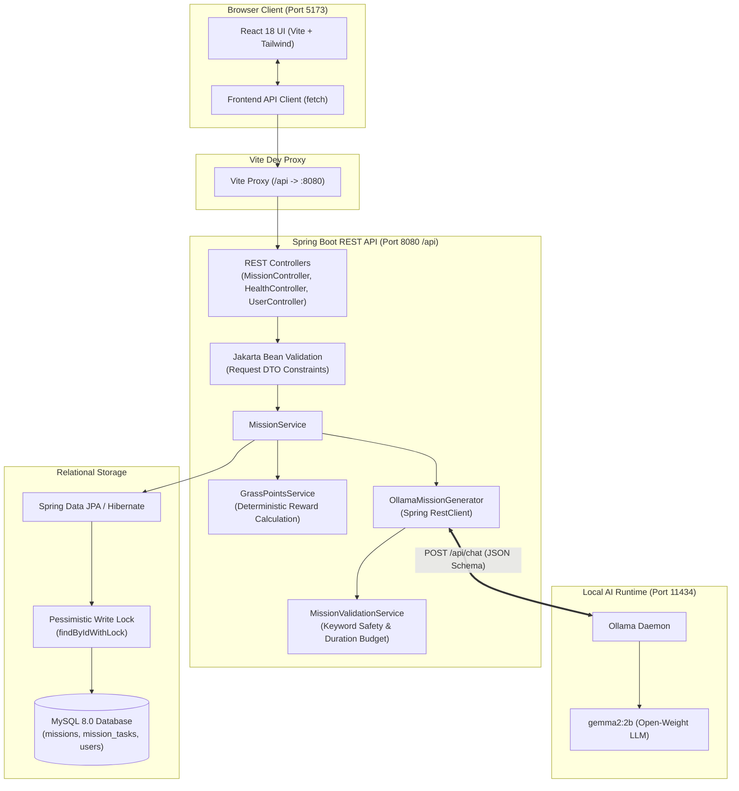

# WildStep 🌱

> **"AI that gets you to close the app."**  
> WildStep uses local open-weight AI to turn a user's mood, available time, goal, and surroundings into personalized outdoor missions. Users complete real-world tasks and earn Grass Points.

[](https://openjdk.org/projects/jdk/21/)
[](https://spring.io/projects/spring-boot)
[](https://react.dev/)
[](https://www.typescriptlang.org/)
[](https://vitejs.dev/)
[](https://tailwindcss.com/)
[](https://www.mysql.com/)
[](https://ollama.com/)
[-blueviolet)](https://ollama.com/library/gemma2)

---

## 📋 Table of Contents

- [Overview & Problem Statement](#-overview--problem-statement)
- [How It Works](#-how-it-works)
- [Screenshots & Demo](#-screenshots--demo)
- [Core Features](#-core-features)
- [Technology Stack](#-technology-stack)
- [System Architecture](#-system-architecture)
- [Request & Response Lifecycle](#-request--response-lifecycle)
- [Project Directory Structure](#-project-directory-structure)
- [Prerequisites](#-prerequisites)
- [Local Setup Guide (Windows PowerShell)](#-local-setup-guide-windows-powershell)
- [REST API Documentation](#-rest-api-documentation)
- [Grass Points Formula](#-grass-points-formula)
- [Safety, Privacy & Guardrails](#-safety-privacy--guardrails)
- [Automated Testing](#-automated-testing)
- [Troubleshooting](#-troubleshooting)
- [Deployment Readiness](#-deployment-readiness)
- [GitHub Repository Renaming Guide](#-github-repository-renaming-guide)
- [Project Status & Roadmap](#-project-status--roadmap)
- [Contributing](#-contributing)
- [License & Acknowledgements](#-license--acknowledgements)

---

## 🌍 Overview & Problem Statement

Modern digital life keeps people tethered to screens, leading to prolonged sitting, digital fatigue, and disconnection from physical surroundings. While numerous wellness apps attempt to address screen time, most paradoxically require users to stay inside the app for meditation, social feeds, or complex habit spreadsheets.

Furthermore, generic suggestions like *"take a 30-minute walk"* fail to account for:
- **How someone actually feels right now** (stressed, tired, anxious, bored, or energetic).
- **Real-world time constraints** (e.g., having exactly 15 minutes between university lectures).
- **Immediate surroundings** (a university campus, a suburban neighborhood, a small balcony, or a local public park).

**WildStep** flips this paradigm. Instead of maximizing user retention inside an interface, WildStep uses a locally hosted, open-weight language model (Google Gemma 2 2B via Ollama) to generate tailored, time-bounded outdoor missions. Users receive grounded physical tasks, close the browser, complete them in the real world, and return to check off tasks and log their deterministic **Grass Points**.

> **Disclaimer:** WildStep is an open-source productivity and wellness utility designed to encourage outdoor physical breaks. It is not a medical application and does not diagnose, treat, or manage anxiety, clinical depression, screen addiction, or any medical condition.

---

## ⚙️ How It Works

The complete end-to-end user workflow operates across a strict separation of concerns between AI generation and backend state management:

```
[User Form Selection] ──► [Spring Boot REST API] ──► [Local Ollama (Gemma 2)]
                                     │                          │
                                     ▼                          ▼
                          [DB Save & Idempotent API] ◄── [Validation Guardrails]
                                     │
                                     ▼
                          [Interactive Task Tracking] ──► [Grass Points Awarded]
```

1. **User Input:** The user selects available time (5–90 min), current mood, personal goal, immediate surroundings, difficulty, and companion context via the React interface.
2. **API Dispatch:** The frontend sends a validated `POST /api/missions/generate` request to the Spring Boot REST API.
3. **Local AI Inference:** Spring Boot constructs a parameterized prompt and invokes the local Ollama instance (`http://localhost:11434/api/chat`) using Spring's `RestClient`.
4. **Structured JSON Output:** The open-weight model (`gemma2:2b`) produces a structured JSON mission consisting of a title, description, 2–5 sequential tasks with minute estimates, and an optional bonus challenge.
5. **Backend Validation Guardrails:** The backend validation engine inspects the generated output, enforcing schema constraints, duration budgets, and scanning for forbidden hazard keywords.
6. **Relational Persistence:** Valid missions and tasks are saved to MySQL in a single `@Transactional` database write, generating permanent record IDs.
7. **Task Presentation:** The React frontend renders the mission card with an interactive progress bar, countdown badges, and task checkboxes.
8. **Real-World Execution:** The user steps outside and performs the physical tasks.
9. **Idempotent Progress Updates:** The user checks off each task via `PATCH /api/missions/{missionId}/tasks/{taskId}/complete`. The backend moves the mission from `CREATED` to `IN_PROGRESS` and eventually `COMPLETED`.
10. **Deterministic Reward:** Upon completion of all required tasks, the backend calculates deterministic Grass Points using database pessimistic locking (`LockModeType.PESSIMISTIC_WRITE`) to prevent duplicate rewards under race conditions.

---

## 📸 Screenshots & Demo

<!--
TODO [Owner]: Place your verified application screenshots in docs/images/ and uncomment the links below.
Recommended screenshots:
1. docs/images/dashboard-health.png  - Main dashboard and "UP" backend status card
2. docs/images/mission-form.png      - Mission preference configuration form
3. docs/images/mission-active.png    - Generated mission with checklist and progress bar
4. docs/images/mission-completed.png - Completed mission with trophy banner and Grass Points
-->

| Mission Configuration Form | Interactive Outdoor Task Checklist |
| :---: | :---: |
| *`docs/images/mission-form.png`* *(Placeholder)* | *`docs/images/mission-active.png`* *(Placeholder)* |

| System Health & Status Banner | Mission Completed & Grass Points Trophy |
| :---: | :---: |
| *`docs/images/dashboard-health.png`* *(Placeholder)* | *`docs/images/mission-completed.png`* *(Placeholder)* |

<!--
TODO [Owner]: Add your live deployment demo URL once hosted.
-->
- **Live Demo:** *Coming soon (see [Deployment Readiness](#-deployment-readiness))*
- **Current Repository URL:** `https://github.com/pushptandekar24-glitch/touchgrass` *(Active remote prior to renaming on GitHub; see [GitHub Repository Renaming Guide](#-github-repository-renaming-guide))*
- **Target Repository URL:** `https://github.com/pushptandekar24-glitch/wildstep` *(Post-rename)*

---

## ✨ Core Features

### Implemented Features (Phases 1a – 1e)
- 🧠 **Local Open-Weight AI Generation:** Uses Ollama with `gemma2:2b` for offline, private, and deterministic mission creation without paid third-party API keys.
- 🛡️ **Multi-Tier Safety Guardrails:** Programmatic keyword filtering blocks unsafe activities (e.g., trespassing, railway proximity, climbing, highway traffic, or approaching strangers).
- ⏱️ **Duration Budget Enforcement:** Ensures the cumulative time of generated tasks never exceeds the user's selected available window.
- 🗄️ **Full Transactional Persistence:** Missions and tasks persist in MySQL with relational integrity (`CascadeType.ALL`, orphan removal).
- 🔄 **Idempotent Task Completion:** Tasks can be completed individually; repeat requests safely return the current state without duplicating point allocations.
- 🔒 **Race Condition Protection:** Pessimistic write locking (`@Lock(LockModeType.PESSIMISTIC_WRITE)`) guarantees Grass Points are awarded exactly once.
- 🎯 **Deterministic Grass Points Engine:** Transparent, mathematically bounded formula rewarding both completion and verified outdoor duration.
- 🔍 **Mission Lookup by ID:** Retrieve any previously saved mission and resume real-time checklist progress.
- 🩺 **Integrated Health Monitoring:** Dedicated `GET /api/health` status check reporting application metadata.
- 🎨 **Responsive Dark UI:** Crafted with React 18, Vite, TypeScript, and Tailwind CSS, featuring real-time progress bars, micro-animations, and accessible form controls.

### Future Roadmap (Non-Implemented Capabilities)
The following items are **not** present in the current release and represent future milestones:
- ❌ Third-party cloud authentication / OAuth2 logins (currently supports anonymous missions and optional local user IDs).
- ❌ GPS geolocation tracking or smartphone sensor validation (tasks are completed via self-reported user action).
- ❌ Live weather API integrations.
- ❌ Photo verification uploads or vision-model analysis.
- ❌ Global social leaderboards or public follower feeds.

---

## 💻 Technology Stack

| Layer | Technology | Version | Purpose |
| :--- | :--- | :--- | :--- |
| **Runtime & Language** | OpenJDK (Java) | `21 LTS` | Core backend runtime utilizing modern language features |
| **Backend Framework** | Spring Boot | `3.4.3` | REST web services, dependency injection, component management (`wildstep-backend`) |
| **Persistence & ORM** | Spring Data JPA / Hibernate | Bundled | Object-relational mapping, custom repository queries, row locking |
| **Database** | MySQL | `8.0+` | Primary relational persistent database engine |
| **Test Database** | H2 Database Engine | Bundled | In-memory database for fast, isolated test suite execution (`jdbc:h2:mem:wildsteptest`) |
| **Database Migrations**| Flyway | `10.x` | Database schema migrations (`V1__init_schema.sql`) |
| **Validation** | Jakarta Bean Validation | Bundled | Request DTO constraint validation (`@NotNull`, `@Size`, `@Min`) |
| **AI Inference Engine**| Ollama | `0.3+` | Local LLM inference server managing model weights |
| **Language Model** | Gemma 2 (Google DeepMind) | `2b` | Open-weight 2-billion parameter model for structured mission planning |
| **HTTP Client** | Spring `RestClient` | Bundled | Synchronous HTTP client connecting backend to Ollama |
| **JSON Serialization** | Jackson | Bundled | JSON serialization, deserialization, and schema binding |
| **Frontend Framework** | React | `18.2.0` | UI component architecture and client-side reactive state (`wildstep-frontend`) |
| **Language** | TypeScript | `5.3.3` | Type safety, enum synchronization, compile-time validation |
| **Build Tool & Bundler**| Vite | `5.4.21`| Fast ESM development server and Rollup production bundler |
| **Styling** | Tailwind CSS | `3.4.1` | Utility-first responsive design, dark mode theme palette |
| **Iconography** | `lucide-react` | `0.344.0`| Crisp vector icons (`Loader2`, `Compass`, `Trophy`, `Leaf`) |
| **Automated Testing** | JUnit 5 & Mockito | Bundled | Unit, WebMvcTest, and end-to-end integration tests (55/55 passing) |

---

## 🏛️ System Architecture

WildStep is intentionally architected as a **clean, modular full-stack application**. The browser communicates strictly with the Spring Boot REST API; the local AI model (Ollama) and the persistent database (MySQL) are completely shielded from public client access.



### Architectural Highlights
- **Backend-Orchestrated AI:** The browser never invokes Ollama directly. This prevents prompt exposure, enables server-side JSON schema enforcement, and ensures safety keyword screening prior to client response.
- **Controlled Concurrency:** Database pessimistic locking on the `Mission` row serializes concurrent task completion calls and eliminates race conditions when granting rewards.
- **Fail-Safe Fallbacks:** If Ollama is offline or times out, Spring Boot captures the `RestClientException` and returns a standardized `503 Service Unavailable` error instead of hanging or crashing.

---

## 🔄 Request & Response Lifecycle

### 1. Mission Generation (`POST /api/missions/generate`)
1. **Validation:** `@Valid` checks that `availableMinutes` is between 5 and 180, `goal` does not exceed 100 characters, and enums match domain definitions.
2. **Prompt Assembly:** `OllamaMissionGenerator` constructs system instructions with strict constraints and requests structured JSON matching the defined schema.
3. **Inference & Retry:** Ollama generates the response. The service retries up to 2 times if JSON parsing fails.
4. **Safety Screening:** `MissionValidationService` verifies that total task duration $\le$ requested duration, task count is between 2 and 5, and scans all text against 15 forbidden safety keywords.
5. **Database Transaction:** The mission and tasks are persisted via `MissionRepository.save(mission)` in a single transaction.
6. **Response:** Returns `201 Created` with database IDs for both the mission and individual tasks.

### 2. Task Completion (`PATCH /api/missions/{missionId}/tasks/{taskId}/complete`)
1. **Locking:** Spring Boot acquires a row write lock (`SELECT ... FOR UPDATE`) on the target mission.
2. **Ownership Check:** Verifies that the task belongs to the specified mission. If the task belongs to another mission, returns `409 Conflict`. If nonexistent, returns `404 Not Found`.
3. **Status Check:** If the mission is `CANCELLED`, rejects completion with `409 Conflict`.
4. **Idempotency Guard:** If the task is already marked `completed = true`, returns the current state immediately without recalculating or adding points.
5. **State Progression:** Marks the task complete. Transitions status from `CREATED` $\to$ `IN_PROGRESS`.
6. **Completion & Rewards:** If all tasks are completed:
   - Sets status to `COMPLETED` and records `completedAt`.
   - Computes Grass Points using the verified duration contract.
   - Updates `Mission.pointsAwarded`.
   - If linked to a real user (`userId != null`), increments `User.totalPoints`.
   - Commits transaction and releases the row lock.

---

## 📁 Project Directory Structure

```
wildstep/
├── .gitignore                          # Git exclusions (build artifacts, logs, .env)
├── README.md                           # Master project documentation
│
├── backend/                            # Spring Boot 3.4.3 backend service (com.wildstep)
│   ├── pom.xml                         # Maven coordinates (groupId: com.wildstep, artifactId: wildstep-backend)
│   └── src/
│       ├── main/
│       │   ├── java/com/wildstep/
│       │   │   ├── WildStepApplication.java      # Spring Boot application entry point
│       │   │   ├── config/
│       │   │   │   ├── OllamaConfig.java         # RestClient bean, timeout & URL configuration
│       │   │   │   └── WebCorsConfig.java        # Cross-Origin Resource Sharing rules
│       │   │   ├── controller/
│       │   │   │   ├── HealthController.java     # GET /api/health monitoring endpoint
│       │   │   │   ├── MissionController.java    # /api/missions lifecycle endpoints
│       │   │   │   └── UserController.java       # /api/users management endpoints
│       │   │   ├── domain/
│       │   │   │   ├── Mission.java              # JPA Entity representing an outdoor mission
│       │   │   │   ├── MissionTask.java          # JPA Entity representing a mission sub-task
│       │   │   │   ├── User.java                 # JPA Entity representing a registered user
│       │   │   │   └── enums/
│       │   │   │       ├── Difficulty.java       # EASY, MEDIUM, HARD
│       │   │   │       ├── EnvironmentType.java  # CAMPUS, PARK, NEIGHBORHOOD, etc.
│       │   │   │       ├── MissionStatus.java    # CREATED, IN_PROGRESS, COMPLETED, CANCELLED
│       │   │   │       ├── Mood.java             # STRESSED, TIRED, ANXIOUS, BORED, ENERGETIC
│       │   │   │       └── Participants.java     # SOLO, FRIENDS, FAMILY
│       │   │   ├── dto/
│       │   │   │   ├── ApiErrorResponse.java     # RFC 7807 structured error payload
│       │   │   │   ├── ApiResponse.java          # Generic envelope: success, message, data
│       │   │   │   ├── MissionGenerateRequestDto.java # Validated mission prompt parameters
│       │   │   │   ├── MissionResponseDto.java   # Full mission detail response
│       │   │   │   ├── MissionTaskResponseDto.java   # Task detail response
│       │   │   │   ├── TaskCompletionRequestDto.java # Optional actual duration payload
│       │   │   │   ├── UserCreateRequestDto.java # User creation payload
│       │   │   │   ├── UserResponseDto.java      # User data response
│       │   │   │   └── ollama/
│       │   │   │       ├── OllamaChatRequest.java    # Structured chat completion request
│       │   │   │       └── OllamaChatResponse.java   # Chat completion response payload
│       │   │   ├── exception/
│       │   │   │   ├── ConflictException.java          # HTTP 409 mapping
│       │   │   │   ├── GlobalExceptionHandler.java     # Centralized @RestControllerAdvice
│       │   │   │   ├── MissionValidationException.java # HTTP 422 mapping
│       │   │   │   ├── OllamaUnavailableException.java # HTTP 503 mapping
│       │   │   │   └── ResourceNotFoundException.java  # HTTP 404 mapping
│       │   │   ├── repository/
│       │   │   │   ├── MissionRepository.java      # JPA repository with pessimistic locking
│       │   │   │   ├── MissionTaskRepository.java  # Task retrieval by mission
│       │   │   │   └── UserRepository.java         # User persistence & lookups
│       │   │   └── service/
│       │   │       ├── GrassPointsService.java     # Deterministic reward calculation
│       │   │       ├── MissionService.java         # Mission generation, retrieval & completion
│       │   │       ├── MissionValidationService.java # Safety keyword & duration checks
│       │   │       ├── UserService.java            # User registration & profile management
│       │   │       └── ai/
│       │   │           ├── MissionGenerator.java   # Inference abstraction interface
│       │   │           └── OllamaMissionGenerator.java # Ollama RestClient integration
│       │   └── resources/
│       │       ├── application.yml                 # Base Spring configuration (context-path /api)
│       │       ├── application-dev.yml             # Development profile (MySQL & Ollama 30s)
│       │       ├── application-test.yml            # Test profile (H2 in-memory & Ollama 5s)
│       │       └── db/migration/
│       │           └── V1__init_schema.sql         # Flyway schema: users, missions, tasks
│       └── test/java/com/wildstep/
│           ├── WildStepApplicationTests.java       # Spring context verification
│           ├── controller/
│           │   ├── MissionControllerTest.java      # MockMvc WebMvcTests for mission routes
│           │   └── UserControllerTest.java         # MockMvc WebMvcTests for user routes
│           └── service/
│               ├── GrassPointsServiceTest.java     # Formula boundary & capping tests
│               ├── MissionLifecycleIntegrationTest.java # H2 End-to-end database tests
│               ├── MissionLifecycleServiceTest.java# Concurrency, state & ownership tests
│               ├── MissionValidationServiceTest.java # Guardrail & keyword screening tests
│               └── ai/
│                   └── OllamaMissionGeneratorTest.java # JSON parsing & retry tests
│
└── frontend/                           # React 18 + Vite + Tailwind CSS client (wildstep-frontend)
    ├── index.html                      # Single-page HTML entry point (<title>WildStep</title>)
    ├── package.json                    # Package metadata (name: "wildstep-frontend")
    ├── postcss.config.js               # PostCSS plugins (Tailwind, Autoprefixer)
    ├── tailwind.config.js              # Tailwind theme, colors & font family
    ├── tsconfig.json                   # TypeScript compiler configuration
    ├── vite.config.ts                  # Vite config with /api -> :8080 proxy
    └── src/
        ├── App.tsx                     # Main application layout, form, & task card
        ├── index.css                   # Global styles & Tailwind base directives
        ├── main.tsx                    # React DOM root render
        ├── api/
        │   └── client.ts               # Typed fetch client connecting to Spring Boot
        ├── components/
        │   ├── HealthStatus.tsx        # System health banner querying /api/health
        │   └── Navbar.tsx              # Header with WildStep logo & Hacktoberfest badge
        └── types/
            └── index.ts                # TypeScript interfaces aligned with backend DTOs
```

---

## 📦 Prerequisites

Ensure the following tools are installed on your machine before running WildStep:

| Requirement | Minimum Version | Verification Command | Notes |
| :--- | :--- | :--- | :--- |
| **Java Development Kit (JDK)** | `21 LTS` | `java -version` | Tested with OpenJDK 21 / 25 |
| **Apache Maven** | `3.9+` | `mvn -version` | Required (no Maven wrapper script included) |
| **Node.js & npm** | `Node 20+` / `npm 10+` | `node -v` ; `npm -v` | Frontend development & build |
| **MySQL Server** | `8.0+` | `mysql --version` | Running locally on port `3306` |
| **Ollama** | `0.3+` | `ollama --version` | Running locally on port `11434` |
| **System Memory (RAM/VRAM)**| `8 GB RAM` | — | Gemma 2 (2B) requires ~2.5 GB RAM/VRAM |

> **Hardware Note:** Gemma 2 (2B) runs comfortably on modern CPU-only setups as well as dedicated GPUs (NVIDIA/AMD/Apple Silicon). If your hardware has limited RAM, ensure Ollama is not competing with other heavy background processes.

---

## 🚀 Local Setup Guide (Windows PowerShell)

Follow this step-by-step walkthrough to get WildStep running locally on Windows using PowerShell.

### Step 1: Clone the Repository
```powershell
# Using current remote repository URL:
git clone https://github.com/pushptandekar24-glitch/touchgrass.git wildstep
cd wildstep

# Note: Once the repository is renamed on GitHub to wildstep, you can clone using:
# git clone https://github.com/pushptandekar24-glitch/wildstep.git
```

### Step 2: Set Up MySQL
Open MySQL Command Line Client or MySQL Workbench:
```sql
-- For fresh installs:
CREATE DATABASE IF NOT EXISTS wildstep CHARACTER SET utf8mb4 COLLATE utf8mb4_unicode_ci;

-- Note for existing local development:
-- If you already have an existing local database named "touchgrass", you may retain it
-- without any data loss. WildStep supports any database name configured via SPRING_DATASOURCE_URL.
```

### Step 3: Configure Environment Variables
Set your environment variables in your current PowerShell session. **Do not hardcode passwords in configuration files.**

```powershell
# Set your MySQL database credentials (replace with your actual local password and database name)
# Backward-compatible with existing "touchgrass" database or new "wildstep" database:
$env:SPRING_DATASOURCE_URL = "jdbc:mysql://localhost:3306/wildstep?createDatabaseIfNotExist=true&useSSL=false&allowPublicKeyRetrieval=true&serverTimezone=UTC"
$env:SPRING_DATASOURCE_USERNAME = "root"
$env:SPRING_DATASOURCE_PASSWORD = "YourSecurePasswordHere"

# Optional: Ollama settings (defaults to localhost:11434 with gemma2:2b)
$env:OLLAMA_BASE_URL = "http://localhost:11434"
$env:OLLAMA_MODEL = "gemma2:2b"
$env:OLLAMA_TIMEOUT_SECONDS = "30"
```
> *Note: Environment variables defined using `$env:VAR = "value"` apply only to the active PowerShell terminal window.*

### Step 4: Pull and Start the Ollama Model
1. Ensure Ollama is running (check the system tray or run `ollama serve`).
2. Pull the default open-weight model:
```powershell
ollama pull gemma2:2b
```
3. Verify that the model is ready:
```powershell
ollama list
```
*(You should see `gemma2:2b` listed with a size of ~1.6 GB).*

### Step 5: Start the Spring Boot Backend
Open a PowerShell terminal in the `backend/` directory:
```powershell
cd backend
mvn clean spring-boot:run
```
The backend initializes database tables via Hibernate, binds to port `8080`, and sets the context path to `/api`.
Confirm startup by testing the health check in your browser or another terminal:
```powershell
curl http://localhost:8080/api/health
```
**Expected response:**
```json
{"success":true,"message":"Backend service operational","data":{"status":"UP","application":"WildStep","phase":"Phase 1a Foundation"}}
```

### Step 6: Start the React Frontend
Open a **new** PowerShell terminal in the `frontend/` directory:
```powershell
cd frontend
npm install
npm run dev
```
Vite will start the dev server at:
👉 **`http://localhost:5173`**

### Step 7: Open the Application
Navigate to `http://localhost:5173` in any modern web browser.
- Fill out the form, generate your first outdoor mission, check off tasks, and collect your Grass Points!

### Step 8: Production Build (Optional)
To test the production frontend build:
```powershell
cd frontend
npm run build
```
This runs TypeScript checking (`tsc`) followed by the Vite production bundler, producing optimized static assets in `frontend/dist/`.

---

## 📡 REST API Documentation

All backend endpoints are prefixed with the servlet context path: **`/api`**.

| Method | Endpoint | Description | Request Body | Success Status |
| :--- | :--- | :--- | :--- | :--- |
| `GET` | `/api/health` | Backend system status & phase | *None* | `200 OK` |
| `POST` | `/api/users` | Register a new user profile | `UserCreateRequestDto` | `201 Created` |
| `GET` | `/api/users/{id}` | Retrieve user profile by ID | *None* | `200 OK` |
| `GET` | `/api/users/username/{username}` | Retrieve user by username | *None* | `200 OK` |
| `GET` | `/api/users` | List all registered users | *None* | `200 OK` |
| `POST` | `/api/missions/generate` | Generate & persist outdoor mission | `MissionGenerateRequestDto` | `201 Created` |
| `GET` | `/api/missions/{missionId}` | Retrieve mission metadata & tasks | *None* | `200 OK` |
| `PATCH`| `/api/missions/{missionId}/tasks/{taskId}/complete` | Mark task complete & calculate points | `TaskCompletionRequestDto` *(Optional)* | `200 OK` |

> *Note: Swagger / SpringDoc OpenAPI UI is not configured in this project. All endpoints are verified through the controller suite and integration tests.*

---

### Endpoint Payloads & Examples

#### 1. Generate Mission (`POST /api/missions/generate`)
```json
{
  "availableMinutes": 20,
  "mood": "STRESSED",
  "goal": "Relax after studying",
  "environmentType": "CAMPUS",
  "difficulty": "EASY",
  "participants": "SOLO",
  "userId": 1
}
```
- `availableMinutes`: Integer between 5 and 180 *(Required)*.
- `mood`: One of `STRESSED`, `TIRED`, `ANXIOUS`, `BORED`, `ENERGETIC` *(Required)*.
- `goal`: String up to 100 characters *(Required)*.
- `environmentType`: One of `CAMPUS`, `PARK`, `NEIGHBORHOOD`, `BALCONY_YARD`, `NATURE_TRAIL` *(Required)*.
- `difficulty`: One of `EASY`, `MEDIUM`, `HARD` *(Required)*.
- `participants`: One of `SOLO`, `FRIENDS`, `FAMILY` *(Required)*.
- `userId`: Numeric user ID *(Optional; if omitted, mission is saved as anonymous)*.

**Success Response (`201 Created`):**
```json
{
  "success": true,
  "message": "Outdoor mission generated successfully",
  "data": {
    "id": 14,
    "userId": 1,
    "title": "Campus Canopy Recharge",
    "description": "Step away from the screens and ground yourself near the campus library grove.",
    "availableMinutes": 20,
    "mood": "STRESSED",
    "goal": "Relax after studying",
    "environmentType": "CAMPUS",
    "difficulty": "EASY",
    "participants": "SOLO",
    "status": "CREATED",
    "pointsAwarded": 0,
    "bonusTask": "Notice three different tree species along the path.",
    "createdAt": "2026-10-11T12:00:00",
    "completedAt": null,
    "tasks": [
      {
        "id": 41,
        "description": "Walk to the oak lawn with your phone put away",
        "estimatedMinutes": 8,
        "taskOrder": 1,
        "completed": false
      },
      {
        "id": 42,
        "description": "Sit on an outdoor bench and focus on ambient nature sounds",
        "estimatedMinutes": 10,
        "taskOrder": 2,
        "completed": false
      }
    ]
  },
  "timestamp": "2026-10-11T12:00:01"
}
```

#### 2. Complete Task (`PATCH /api/missions/{missionId}/tasks/{taskId}/complete`)
Payload is optional. To claim an outdoor duration bonus, provide `actualDurationMinutes`:
```json
{
  "actualDurationMinutes": 20
}
```
**Success Response (`200 OK`):**
```json
{
  "success": true,
  "message": "Task completed successfully",
  "data": {
    "id": 14,
    "status": "COMPLETED",
    "pointsAwarded": 90,
    "completedAt": "2026-10-11T12:25:00",
    "tasks": [
      { "id": 41, "completed": true, "taskOrder": 1 },
      { "id": 42, "completed": true, "taskOrder": 2 }
    ]
  }
}
```

#### 3. Standardized Error Payload (RFC 7807)
When validation or processing fails, Spring Boot returns a uniform error response:
```json
{
  "type": "https://wildstep.ai/errors/mission-validation-failed",
  "title": "Mission Validation Failed",
  "status": 422,
  "detail": "Total task duration (25 mins) exceeds user available time (20 mins).",
  "instance": "/api/missions/generate",
  "timestamp": "2026-10-11T12:00:02"
}
```

---

## 🏆 Grass Points Formula

Grass Points are calculated deterministically on the backend via [`GrassPointsService.java`](backend/src/main/java/com/wildstep/service/GrassPointsService.java). The algorithm rewards both task commitment and real-world outdoor exposure while maintaining an upper ceiling.

$$\text{Grass Points} = \min\left(150, \, 50 + (\text{completedTasks} \times 10) + \left\lfloor\frac{\text{actualDurationMinutes}}{5}\right\rfloor \times 5\right)$$

### Component Breakdown
1. **Base Reward ($50\text{ pts}$):** Granted immediately upon completing all tasks in a mission.
2. **Task Completion Bonus ($10\text{ pts / task}$):** Multiplied by the total number of verified tasks (e.g., $3\text{ tasks} \times 10 = 30\text{ pts}$).
3. **Verified Outdoor Duration Bonus ($5\text{ pts / 5 min}$):** Awarded for every full 5-minute block spent outdoors based on client-provided `actualDurationMinutes`. The calculation uses integer division ($\lfloor \text{minutes} / 5 \rfloor$), ensuring partial intervals do not award unearned points.
4. **Hard Ceiling ($150\text{ pts}$):** Total points can never exceed 150 points for a single mission, discouraging excessive single-session gaming.
5. **Zero / Incomplete Missions:** If 0 tasks are completed or tasks remain pending, 0 points are awarded.

### Example Calculation
- Mission: 3 tasks completed.
- Verified Duration: 23 minutes.
- Calculation:
  $$\text{Points} = 50 + (3 \times 10) + \left(\lfloor 23 / 5 \rfloor \times 5\right) = 50 + 30 + 20 = 100\text{ Grass Points}$$

### Account Updating Rules
- **Registered User Missions (`userId != null`):** The calculated points are persisted in `Mission.pointsAwarded` and atomically added to `User.totalPoints`.
- **Anonymous Missions (`userId == null`):** Points are recorded on the `Mission` record for display purposes, but no user record is touched.
- **Idempotency Guarantee:** Once a mission reaches `COMPLETED`, repeated calls to complete any task return the existing state without modifying point balances.

---

## 🛡️ Safety, Privacy & Guardrails

### 1. Safety Guardrails
Open-weight models can occasionally hallucinate dangerous tasks. WildStep enforces rigorous, defense-in-depth safety rules:
- **System Prompt Rules:** The LLM is explicitly forbidden from recommending trespassing, restricted zones, dangerous climbing, swimming in rivers, or approaching strangers.
- **Deterministic Keyword Scanning:** The `MissionValidationService` checks the combined title, description, tasks, and bonus task against a blocklist:
  ```
  trespass, restricted area, private property, climb building, climb fence, climb tree,
  climb roof, railway, train tracks, traffic road, highway, approach stranger,
  talk to stranger, swim in river, dangerous animal, illegal
  ```
  If any forbidden phrase appears, the entire mission is rejected (`HTTP 422`).
- **Time Bounds:** Total task duration is strictly checked against the user's available time to avoid physical exhaustion.

### 2. User Physical Safety Guidance
Users should always exercise personal judgment:
- Obey local laws, park regulations, and private property boundaries.
- Stay on marked footpaths and well-lit pedestrian pathways.
- Do not engage in tasks that feel uncomfortable, unsafe, or unsuitable for current weather.
- Always remain aware of your physical surroundings, vehicles, and terrain.

### 3. Privacy & Secrets
- **No Telemetry or Tracking:** The application performs no GPS background tracking, IP tracking, or user fingerprinting.
- **Local AI:** Prompts and generated missions remain strictly on your local machine; nothing is sent to third-party cloud AI vendors.
- **Secrets Management:** The `.gitignore` file excludes `.env`, `*.log`, and build outputs. Passwords and keys must always be passed via environment variables.

---

## 🧪 Automated Testing

The project maintains comprehensive test coverage across both backend services and the frontend client.

### Backend Test Suite (`mvn test`)
To run all backend unit and integration tests:
```powershell
cd backend
mvn test
```

**Verified Test Suite Results (55/55 Tests Passing):**
- [`GrassPointsServiceTest`](backend/src/test/java/com/wildstep/service/GrassPointsServiceTest.java) *(16 tests)*: Formula validation, boundary values, zero tasks, negative durations, and capping at 150 points.
- [`MissionLifecycleServiceTest`](backend/src/test/java/com/wildstep/service/MissionLifecycleServiceTest.java) *(14 tests)*: Persistence, retrieval, partial completion, anonymous missions, wrong-mission task rejection, and cancellation handling.
- [`MissionControllerTest`](backend/src/test/java/com/wildstep/controller/MissionControllerTest.java) *(10 tests)*: WebMvc tests for generation, retrieval, and completion (`200`, `201`, `400`, `404`, `409`, `422`, `503`).
- [`OllamaMissionGeneratorTest`](backend/src/test/java/com/wildstep/service/ai/OllamaMissionGeneratorTest.java) *(7 tests)*: JSON parsing, retry loops, and service offline handling.
- [`UserControllerTest`](backend/src/test/java/com/wildstep/controller/UserControllerTest.java) *(4 tests)*: User CRUD operations and validation errors.
- [`MissionValidationServiceTest`](backend/src/test/java/com/wildstep/service/MissionValidationServiceTest.java) *(4 tests)*: Keyword safety filters, duration overflow, and task count constraints.
- [`MissionLifecycleIntegrationTest`](backend/src/test/java/com/wildstep/service/MissionLifecycleIntegrationTest.java) *(2 tests)*: Full Spring Boot end-to-end integration tests using in-memory H2 database (`@ActiveProfiles("test")`).
- [`WildStepApplicationTests`](backend/src/test/java/com/wildstep/WildStepApplicationTests.java) *(1 test)*: Spring context loading verification.

### Frontend Production Build (`npm run build`)
To verify TypeScript compilation and asset bundling:
```powershell
cd frontend
npm run build
```
*(Runs `tsc && vite build`; verifies zero TypeScript errors and compiles cleanly to `dist/`).*

---

## 🔧 Troubleshooting

### 1. MySQL Access Denied (`Error 1045`)
- **Symptom:** Spring Boot startup fails with `Access denied for user 'root'@'localhost' (using password: YES)`.
- **Fix:** Ensure `$env:SPRING_DATASOURCE_PASSWORD` is set in the **same terminal window** where you run `mvn spring-boot:run`. If using MySQL without a password, pass an empty string: `$env:SPRING_DATASOURCE_PASSWORD = ""`.

### 2. Port 8080 or 5173 Already in Use
- **Symptom:** `Web server failed to start. Port 8080 was already in use.`
- **Fix:** Identify and stop the process occupying the port:
  ```powershell
  # Find PID using port 8080
  Get-Process -Id (Get-NetTCPConnection -LocalPort 8080).OwningProcess | Stop-Process -Force
  ```

### 3. Ollama Unavailable (`HTTP 503: AI Inference Service Unavailable`)
- **Symptom:** Mission generation returns `503 Service Unavailable`.
- **Fix:** Confirm that Ollama is running by opening `http://localhost:11434` in your browser. Start Ollama if it is stopped:
  ```powershell
  ollama serve
  ```

### 4. Model Not Found (`Ollama returned error: model 'gemma2:2b' not found`)
- **Symptom:** Backend logs show model missing.
- **Fix:** Download the model via Ollama:
  ```powershell
  ollama pull gemma2:2b
  ```

### 5. Mission Validation Failed (`HTTP 422 Unprocessable Entity`)
- **Symptom:** UI displays `Mission Validation Failed` or safety rejection.
- **Cause:** The model generated text containing a blocked keyword or exceeded available minutes.
- **Fix:** Ollama automatically retries up to 2 times. If this occurs on a specific prompt, rephrase your goal or adjust available time slightly.

### 6. Frontend Cannot Reach Backend
- **Symptom:** Mission submission fails with connection error.
- **Fix:** Check that Spring Boot is running on port 8080. Verify that `vite.config.ts` includes the `/api` proxy targeting `http://localhost:8080`.

---

## 🚢 Deployment Readiness

Deploying WildStep to a remote production environment requires coordinating three core layers:

```
[Static Frontend Host]  ──►  [Spring Boot API Server]  ──►  [MySQL Database]
(Vercel / Netlify / CDN)        (Docker / VM / Cloud Run)           (Managed DB)
                                           │
                                           ▼
                                 [Ollama Inference Host]
                               (Self-Hosted GPU / Cloud VM)
```

### Critical Architectural Limitation
> ⚠️ **Important:** Deploying only the React frontend and Spring Boot backend is **not sufficient** for mission generation. The backend must be able to reach a working Ollama runtime loaded with `gemma2:2b`.

### Production Deployment Checklist
1. **Ollama Hosting:**
   - Host Ollama on a GPU/CPU cloud instance (e.g., RunPod, AWS EC2, or a dedicated private server).
   - Set `OLLAMA_BASE_URL` on the Spring Boot server to the internal network address of that host (e.g., `http://ollama-service:11434`).
   - Never expose port 11434 publicly to the Internet.
2. **Spring Boot Containerization:**
   - Package backend into a container image using the Spring Boot Maven plugin or a multi-stage Dockerfile (`eclipse-temurin:21-jre`).
   - Inject database credentials using production secrets (`SPRING_DATASOURCE_URL`, `SPRING_DATASOURCE_USERNAME`, `SPRING_DATASOURCE_PASSWORD`).
3. **Database Configuration:**
   - Enable Flyway migrations for schema creation in production (`spring.flyway.enabled: true`).
   - Change Hibernate `ddl-auto` from `update` to `validate` in production.
4. **CORS & Domain Mapping:**
   - Update `WebCorsConfig.java` to restrict allowed origins to your production frontend domain (e.g., `https://wildstep.example.com`).
5. **Frontend Hosting:**
   - Build with `npm run build` and deploy `dist/` to a CDN or static web host.
   - Configure a reverse proxy or set the production API URL accordingly.

---

## 🔄 GitHub Repository Renaming Guide

The project code and branding have been migrated to **WildStep**. To complete the transition on GitHub:

### 1. Rename the Repository on GitHub
1. Open your repository on GitHub: `https://github.com/pushptandekar24-glitch/touchgrass`
2. Navigate to **Settings** > **General**.
3. Under **Repository name**, change `touchgrass` to `wildstep`.
4. Click **Rename**. *(GitHub automatically sets up web and Git redirects from the old URL to the new one).*

### 2. Update Local Git Remote URL
After renaming on GitHub, update your local Git remote URL in PowerShell:
```powershell
git remote set-url origin https://github.com/pushptandekar24-glitch/wildstep.git
```
Verify the remote URL has updated:
```powershell
git remote -v
```

---

## 🗺️ Project Status & Roadmap

### Development Phases
- [x] **Phase 1a:** Backend foundation (Spring Boot 3.4, Java 21, MySQL, Flyway schema, standardized errors).
- [x] **Phase 1b:** AI generation engine (Ollama RestClient, Gemma 2 2B, structured schema, safety screening).
- [x] **Phase 1c:** Mission lifecycle & Grass Points (persistence, task completion, pessimistic write locking, idempotency).
- [x] **Phase 1d:** Frontend integration (React 18, Vite proxy, aligned enums, interactive checklist, health card).
- [x] **Phase 1e:** Project rebrand to WildStep & full test suite migration (com.wildstep, 55/55 tests passing).
- [ ] **Phase 2 (Future):** Cloud deployment, user authentication, streak tracking, and photo journaling.

---

## 🤝 Contributing

Contributions to WildStep are welcome! Whether you are fixing bugs, improving documentation, or optimizing prompts, here is how you can help:

1. **Fork the Repository:** Create your personal fork on GitHub.
2. **Create a Feature Branch:**
   ```bash
   git checkout -b feature/your-feature-name
   ```
3. **Keep Changes Focused:** Address one bug or feature per pull request.
4. **Run Automated Tests:** Ensure both backend tests and frontend compilation pass:
   ```bash
   cd backend && mvn test
   cd ../frontend && npm run build
   ```
5. **Submit a Pull Request:** Open a PR against `main` with a clear description of your changes, referencing any relevant issues.

---

## 📜 License & Acknowledgements

### License
*Note: A license file has not yet been designated by the project maintainers. Contributors and users should review the repository for a future `LICENSE` file (e.g., MIT or Apache 2.0).*

### Acknowledgements
- **[Google DeepMind](https://deepmind.google/technologies/gemma/):** For releasing the high-quality open-weight Gemma 2 model family.
- **[Ollama](https://ollama.com/):** For providing an accessible, fast local inference runtime.
- **[Spring Boot & Spring Data](https://spring.io/):** For robust enterprise-grade REST architecture and concurrency management.
- **[Hacktoberfest 2026](https://hacktoberfest.com/):** Inspired by the Week 1 "Touch Grass" open-source coding challenge.
